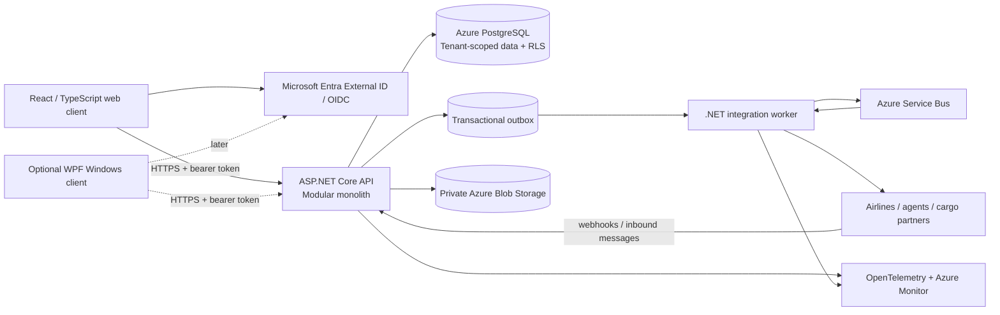

# Airfreight TMS: Definitive Build Plan and Architecture

**Architecture baseline — November 19, 2026**

## 1. Executive decision

Build a **multi-tenant, airfreight-forwarding SaaS** first. Provide a browser client as the primary product. Keep the API contract suitable for a later Windows desktop client. Both clients must use the same backend, authorization rules, data model, and integrations. Do not build a second backend or connect a desktop client directly to the database.

This project is an airfreight forwarder TMS, based on the required parties, airports, airlines, Incoterms, HAWBs, and MAWBs. It is not initially a truck-fleet dispatch system. Truck/driver assignment, GPS fleet tracking, road route optimization, load boards, and trucking EDI formats are outside the first release unless the business confirms they are required.

| Concern | Decision |
|---|---|
| Product | B2B SaaS for freight-forwarding organizations, with tenant and branch boundaries |
| Web client | React + TypeScript single-page application, built with Vite |
| Optional native client | WPF on current .NET, online-connected to the same API; defer its delivery until the web workflows stabilize |
| Backend | C# + ASP.NET Core Web API on .NET 10 LTS |
| Application shape | One modular monolith, with a separately deployed worker using the same codebase and module boundaries |
| Primary database | Azure Database for PostgreSQL Flexible Server; PostGIS is excluded until a real spatial query requirement exists |
| Messaging | PostgreSQL transactional outbox plus Azure Service Bus Standard for durable integration work, retries, and dead-letter handling |
| Documents | Private Azure Blob Storage; metadata, ownership, versions, and audit references in PostgreSQL |
| Cloud | Microsoft Azure, using managed services and Infrastructure as Code |
| Offline operation | Excluded from Release 1. Offline desktop use requires a separately designed synchronization and conflict-resolution capability. |

### Product goal and first measurable milestone

**Product goal:** deliver a secure airfreight-forwarding TMS that lets a forwarding team manage approved operational data, create and track shipments, issue and correct HAWBs/MAWBs, and exchange shipment data with at least one onboarded air-cargo partner. Tenant and branch access, approvals, and audit history apply across the workflow.

**First milestone (M1): secure shipment draft vertical slice.** A manager can approve the party data an operator needs; an authorized operator can create and validate a straight-shipment draft from that data; the API enforces role, tenant, and branch access; and the actions appear in an audit history. The team can run and demonstrate this flow locally or in a development environment.

M1 is reached when the workflow and role matrix are reviewed, the protected API and persistence boundaries reject cross-tenant access, the manager approval and operator draft flow work end to end, and the repeatable setup and acceptance checks are documented. The GitHub milestone tracks issues #1, #3, #4, and #5. Issue #2 (partner contract discovery) proceeds in parallel and gates the later e-AWB integration milestone. No due date is set until the two developers estimate the work and confirm access to an operations reviewer and partner materials.

Microsoft currently lists .NET 10 as LTS and .NET 11 as STS, both supported through November 14, 2028. This baseline selects .NET 10 for its LTS release track; pin a current patch and schedule framework upgrades before end of support. [Microsoft .NET support policy](https://dotnet.microsoft.com/en-us/platform/support/policy/dotnet-core)

## 2. Scope and operating assumptions

Release 1 delivers the controlled operational path from reference data through shipment creation, air waybill handling, shipment milestones, and basic financial visibility. It includes Admin, Manager, Operator, and Finance roles; backend permission enforcement; manager approvals; audit history; and tenant isolation.

The first production integration will be selected with a participating airline or cargo partner. Support for a standard does not mean a partner is ready to transact: e-AWB implementation requires partner agreements and compatible operating procedures. [IATA e-freight/e-AWB](https://www.iata.org/en/programs/cargo/e/efreight)

Release 1 excludes a general-purpose workflow designer, general ledger/accounting, customs filing, fleet management, native mobile apps, AI dispatch, and full offline synchronization. Integration points and domain boundaries should allow later additions without pretending these are part of the first release.

## 3. Logical architecture

### Runtime and deployment

- **React client:** TypeScript SPA hosted as static assets on Azure Static Web Apps. Authenticate directly with Entra External ID using MSAL and the OIDC authorization-code flow with PKCE. The API validates access tokens and independently enforces all business permissions; frontend route protection is for user experience only. [Azure Static Web Apps](https://learn.microsoft.com/en-us/azure/static-web-apps/overview/) · [Microsoft identity platform SPA guidance](https://learn.microsoft.com/en-us/entra/msal/msal-authentication-flows)
- **Identity:** Microsoft Entra External ID for customer sign-in and MFA. Keep tenant membership, business roles, branch scope, and permissions in the TMS domain database; identity-provider groups alone are not the authorization model. [Microsoft Entra External ID](https://learn.microsoft.com/en-us/entra/external-id/customers/overview-solutions-customers)
- **API and worker:** Containerized ASP.NET Core API and .NET worker in Azure Container Apps. The API serves interactive requests. The worker continuously processes Service Bus messages; use Container Apps Jobs for finite scheduled or one-off maintenance tasks. [Azure Container Apps jobs and apps](https://learn.microsoft.com/en-us/azure/container-apps/jobs)
- **Database:** Azure Database for PostgreSQL Flexible Server, reachable privately from application workloads, with production high availability, automated backups, and point-in-time restore configured to agreed recovery objectives. [Azure Database for PostgreSQL](https://learn.microsoft.com/en-us/azure/postgresql/overview)
- **Messaging:** Azure Service Bus Standard for the first production integration, with queues/topics, bounded retries, dead-letter queues, and operator-visible failure handling. Upgrade to Premium only if measured throughput, latency, or isolation requirements demand it. Consumers must be idempotent: broker redelivery is possible even when duplicate-send detection is enabled. [Service Bus delivery and duplicate guidance](https://learn.microsoft.com/en-us/azure/service-bus-messaging/service-bus-message-loss-and-duplicates) · [Dead-letter queues](https://learn.microsoft.com/en-us/azure/service-bus-messaging/service-bus-dead-letter-queues)
- **Files:** Private Blob Storage for generated AWBs, shipment documents, and uploaded files. Use short-lived scoped upload/download access where direct transfer is needed. Store file metadata, version, owner, checksum, retention class, and shipment association in the database.
- **Secrets and observability:** Managed identities, Key Vault for secrets and certificates, OpenTelemetry traces/metrics/logs, and Azure Monitor alerts. Propagate a correlation ID across HTTP requests, outbox records, partner messages, worker jobs, and audit entries.
- **Delivery infrastructure:** Separate development, staging, and production environments; define cloud resources in Bicep; deploy through GitHub Actions with review gates and database migrations that support safe rollout and rollback.

Azure’s guidance describes a modular monolith as a valid single deployment with internal modules, while microservices add independent deployment and scaling along with distributed-system complexity. Start modular; extract a component only when independent scale, isolation, or ownership is demonstrated. [Microsoft .NET architecture guidance](https://learn.microsoft.com/en-us/dotnet/architecture/microservices/key-takeaways)

## 4. Backend module boundaries

All modules are initially in one API deployment and one PostgreSQL database. Modules own their business rules and write paths; other modules use explicit application contracts rather than reaching into another module’s tables.

1. **Identity and tenancy:** organizations, branches, users, memberships, role assignments, permission catalog, and tenant context.
2. **Master data:** parties, party roles, addresses, contacts, customer defaults, airports, airlines, agents, carriers, and Incoterms.
3. **Shipment operations:** shipment lifecycle, parties per shipment, route legs, cargo, pickup/delivery instructions, and operational milestones.
4. **Air waybills and documents:** HAWB/MAWB relationships, number allocation, document versions, generation, issue/correction history, and file metadata.
5. **Integrations:** canonical internal messages, partner adapters, inbound/outbound payload records, acknowledgements, retries, idempotency, and replay controls.
6. **Finance:** shipment cost and revenue lines, currency, margin visibility, invoice status, and approvals. General ledger and tax/accounting compliance remain out of scope unless specified.
7. **Audit and approvals:** append-only business audit events, approval requests and decisions, and privileged-action history.

## 5. Core data model and rules

### Business entities

- **Tenant and branch:** a freight-forwarding company is the SaaS tenant. Branches are operational scopes within that tenant, not separate tenants.
- **Party:** canonical tenant-owned organization or person with multiple addresses, contacts, and business roles. A party can be a customer, shipper, consignee, notify party, destination agent, airline, or inland carrier. Role-specific details live in profiles or relations rather than duplicating the same organization.
- **Reference catalogs:** airports, countries, and Incoterm codes are controlled, versioned catalogs. Tenant-specific business parties, contacts, service agreements, instructions, and billing data are managed as tenant data.
- **Shipment:** tenant/branch-owned operational record, customer, shipper, consignee, notify party, optional destination agent, Incoterm/location, shipment type, cargo, owner, and explicit status.
- **Shipment party snapshot:** retain the address and relevant party details used for an issued document or completed shipment. Later master-data edits must not silently alter historical shipment documents.
- **Route:** ordered air and optional ground legs, with airports, airline/carrier, flight or service identifiers, scheduled times, and operational state. Represent flight legs explicitly; do not infer an air route from generic origin/destination fields alone.
- **Cargo:** pieces, packaging, gross weight, dimensions, goods description, and any required handling declarations. Weight/chargeable-weight rules must be explicit and configurable where partner or commercial rules vary.
- **Consolidation and AWBs:** a consolidation can contain multiple house shipments/HAWBs under a MAWB. Allocate numbers transactionally and enforce uniqueness. Issued documents are immutable versions; corrections create a new version with an audit trail.
- **Milestone and integration message:** keep the normalized shipment timeline separate from the raw partner message and the e-AWB exchange state. Map partner events to internal milestones without losing source code, timestamps, acknowledgements, or payload reference.
- **Finance line:** separate cost from revenue, retain currency and source, and independently authorize visibility of cost, sell rate, and margin.
- **Approval and audit:** record request, approver, decision, reason, timestamp, and the affected entity. Audit records identify actor, tenant, action, entity, correlation ID, and redacted before/after values where appropriate.

### Tenant isolation and authorization

- Put `tenant_id` on every tenant-owned row and tenant-owned object-storage path. Use tenant-scoped unique keys and indexes; derive tenant identity from the authenticated membership, never trust an arbitrary tenant ID supplied by the client.
- Apply tenant and branch scope in the API policy layer on every read and write. Add PostgreSQL Row-Level Security as defense in depth. The runtime DB role must not own protected tables or have `BYPASSRLS`; establish tenant context transaction-locally for each request and verify that pooled connections cannot retain another request’s context. PostgreSQL defaults to denying rows when RLS is enabled without a matching policy, but table owners normally bypass RLS. [PostgreSQL row security](https://www.postgresql.org/docs/19/ddl-rowsecurity.html)
- Define permissions as actions on resources, such as `customer.edit`, `shipment.create`, `shipment.validate`, `awb.issue`, `finance.cost.view`, and `audit.view`. Enforce permissions in application policies on every API operation.
- Seed Admin, Manager, Operator, and Finance role templates. Implement limited manager delegation and restricted destructive actions. Do not build custom-role editing in Release 1; keep the permission catalog data-driven so it can be added later.
- Do not equate hidden UI controls with authorization. Test cross-tenant and cross-branch access paths explicitly, including search, exports, file downloads, integration callbacks, and background jobs.

### Workflow rules

- Keep shipment status separate from AWB state and external message state. Define legal transitions and who may execute each transition; invalid or repeated transitions return a safe, explainable error.
- Operators can use approved master data. If a consignee or other controlled party is missing, the operator submits a request; a manager approves or rejects with a reason; approval creates or links the master record and returns the operator to the shipment.
- Validate mandatory shipment, party, route, and cargo fields before validation or AWB issue. A manager-only action must remain manager-only even if a client calls the API directly.
- e-AWB exchange must record message version, target partner, send time, acknowledgement/rejection, error detail, and correction/resend relationship. IATA guidance describes FWB/XFWB air waybill messages, FHL/XFHL house information for consolidations, and responses/statuses including FMA/FNA and FOH/RCS. Confirm the precise formats and agreements with the first partner before committing conformance scope. IATA recommends Cargo-XML; Cargo-IMP is no longer maintained. [IATA implementation playbook](https://www.iata.org/contentassets/4bc75639b37641ba88f2e81e5516a020/e-awb-implementation-playbook.pdf) · [IATA Cargo-XML Toolkit](https://www.iata.org/en/publications/manuals/cargo-xml-toolkit)
- Archive master data referenced by historical shipments; do not hard-delete referenced data. Provide controlled cancel, void, correction, and supersession flows for business records and issued documents.

## 6. Transactional and asynchronous design

Shipment edits, approval decisions, AWB number allocation, and audit/outbox creation commit in one PostgreSQL transaction. The API returns success only after the business transaction commits. The same transaction writes an outbox record for each external event that must be published.

The worker publishes outbox records to Service Bus and processes inbound partner messages. Use stable message IDs, idempotent consumers, bounded retry with backoff, dead-letter queues, and replay tools with permission checks and audit records. Preserve per-shipment ordering only for message flows that require it; do not serialize unrelated tenants or shipments. Microsoft’s guidance notes that durable messaging must account for duplicate processing, and the outbox pattern commits the business record and event together. [Transactional outbox pattern](https://learn.microsoft.com/en-us/azure/architecture/databases/guide/transactional-out-box-cosmos) · [Service Bus delivery guarantees](https://learn.microsoft.com/en-us/azure/service-bus-messaging/service-bus-message-loss-and-duplicates)

SignalR is optional for live operator dashboards after the core workflow is stable. It only notifies connected clients; PostgreSQL remains the source of truth and Service Bus/outbox remain the durable integration path. [ASP.NET Core SignalR](https://learn.microsoft.com/en-us/aspnet/core/signalr/introduction?view=aspnetcore-10.0)

## 7. Client strategy: SaaS and desktop

The React web client is the first supported client and defines the operational UX. Use Vite because this authenticated business application does not need server-side rendering for search indexing. Host the static bundle through Azure Static Web Apps; Microsoft supports React-style static applications and identity integration. [Azure Static Web Apps overview](https://learn.microsoft.com/en-us/azure/static-web-apps/overview/)

After the web workflows and API contracts have stabilized, add a WPF Windows client only if customer research confirms a need for native Windows behavior, local peripheral access, or a desktop-specific workflow. It authenticates through the same identity provider and calls the same ASP.NET Core API. Do not introduce a second database or business-rule implementation. WPF is Windows-only. [Microsoft WPF overview](https://learn.microsoft.com/en-us/dotnet/desktop/wpf/overview)

If offline work becomes a launch requirement, pause desktop implementation and design local encrypted storage, queued commands, conflict resolution, data expiry, and reauthentication first. An online WPF shell is not an offline architecture.

## 8. Delivery roadmap and exit criteria

### Phase 0 — Domain and partner validation

- Confirm SaaS tenant definition, branch scope, first customer profile, and whether a desktop client is actually needed.
- Walk through shipment creation, validation, booking, consolidation, AWB correction, arrival/delivery, cancellation, and invoicing with an airfreight operations expert.
- Obtain one partner’s message specifications, onboarding steps, test environment, and agreement requirements. Agree on supported lanes and exception handling.
- Define retention, data residency, recovery objectives, availability target, expected shipment/message volumes, and the first release boundary.

**Exit:** signed workflow map, permission matrix, glossary, partner interface contract, initial service-level objectives, and reviewed architecture decisions.

### Phase 1 — Secure platform and first vertical slice

- Create the React and .NET solution, PostgreSQL migrations, local development environment, Bicep environments, CI/CD, structured logs, and OpenAPI contracts.
- Implement OIDC sign-in, tenant/branch membership, seeded role templates, backend authorization, RLS, audit events, and tenant-aware file access.
- Deliver one thin end-to-end slice: manager creates a customer, operator creates a shipment draft from approved data, and each action appears in the audit history.

**Exit:** role-policy matrix works through the API, tenant boundaries are verified, migrations deploy repeatably, and the vertical slice can be demonstrated.

### Phase 2 — Master data and approval workflow

- Deliver parties, roles, multi-address/contact records, customer defaults, airport/Incoterm catalogs, duplicate detection, archive behavior, and new-party requests.
- Add approval reasons, notification, and audit history.

**Exit:** operators cannot modify master data, new-party requests do not create duplicates, and approved data can be selected in shipment entry.

### Phase 3 — Shipment operations

- Deliver shipment create/edit, party assignments, route legs, cargo, pickup/delivery instructions, validation, milestones, filters/search, and operational event history.
- Add explicit transition policies, optimistic concurrency for simultaneous edits, and idempotency for repeated commands.

**Exit:** representative straight and consolidated shipment scenarios pass, invalid transitions are rejected, and concurrent edits do not silently overwrite one another.

### Phase 4 — AWBs and first partner integration

- Deliver consolidation grouping, HAWB/MAWB relationships, unique number allocation, immutable issued versions, printable output, and integration payload/version tracking.
- Implement the first airline/partner adapter, acknowledgement/rejection workflows, correction/resend handling, bounded retries, DLQ inspection, and audited replay.

**Exit:** partner sandbox round-trip is demonstrated with successful, rejected, duplicate, delayed, and retried messages; issued document history remains correct.

### Phase 5 — Finance, pilot readiness, and production

- Deliver shipment cost/revenue lines, margin permissions, basic invoice status, and approvals required by the agreed first release. Defer general-ledger and tax/accounting integrations.
- Run security, tenant-isolation, workflow, document, integration, and performance validation using realistic data. Validate backups and point-in-time restore; prepare dashboards, alerts, runbooks, and support ownership.
- Pilot with a limited operations group, resolve workflow gaps, and then widen access by tenant/branch.

**Exit:** business owner signs off core operational scenarios, critical security and integration defects are closed, recovery is demonstrated, and support staff can inspect and replay failed partner exchanges under permission control.

### Phase 6 — Windows client, only if justified

- Reuse the published API and permission contracts for a WPF client. Do not duplicate domain logic or database access.
- Define update/installation, endpoint management, support, and any device/peripheral requirements. Treat offline capability as a separate approved scope.

## 9. Quality, reliability, and performance gates

- **Business correctness:** automated unit and integration coverage for transitions, approvals, tenant scope, AWB allocation, correction/versioning, and billing idempotency; contract tests for partner formats.
- **Security:** authentication, backend permission enforcement, cross-tenant negative tests, least-privilege managed identities, private database/blob access, secret rotation, and audit review.
- **Integration resilience:** partner downtime, duplicate messages, delayed acknowledgements, malformed payloads, worker restarts, and safe replay are exercised before launch.
- **Data recovery:** backup retention, point-in-time recovery, and restore runbook are validated before production; agree RPO and RTO with the business rather than assuming defaults.
- **Performance:** define p95 latency and throughput targets from expected concurrent operators, shipments per day, and partner message bursts. Measure early with representative data; do not partition tables, add Redis, or add read replicas until measurements justify them. Microsoft recommends workload-aligned, realistic performance tests. [Azure Well-Architected performance testing](https://learn.microsoft.com/en-us/azure/well-architected/performance-efficiency/performance-test)
- **Operations:** every failed integration is visible with partner, shipment, correlation ID, last attempt, and next action. Alert on queue age, repeated failures, database pressure, API error rates, and backup/restore status.

## 10. Architectural decisions to preserve

1. **The airfreight domain is the product boundary.** Add road-fleet capabilities only when a real workflow requires them.
2. **The API is the security and business-rule boundary.** Both web and desktop clients are untrusted clients.
3. **PostgreSQL is the transactional source of truth.** Blob storage holds file bytes; Service Bus transports work; SignalR, if added, only pushes live notifications.
4. **External standards live in adapters.** Normalize partner messages into stable internal commands/events and retain raw payload references for support and audit.
5. **Tenant isolation is foundational.** Tenant and branch identifiers, authorization policies, and tenant-aware storage are part of every domain feature from day one.
6. **No arbitrary optimization or estimates.** Measure actual operational workloads and partner behavior before adding microservices, spatial indexing, caching, partitioning, or performance commitments.

## 11. Primary research references

- [IATA e-freight/e-AWB](https://www.iata.org/en/programs/cargo/e/efreight)
- [IATA e-AWB implementation playbook](https://www.iata.org/contentassets/4bc75639b37641ba88f2e81e5516a020/e-awb-implementation-playbook.pdf)
- [IATA Cargo-XML Toolkit](https://www.iata.org/en/publications/manuals/cargo-xml-toolkit)
- [Microsoft .NET support policy](https://dotnet.microsoft.com/en-us/platform/support/policy/dotnet-core)
- [Microsoft Entra External ID](https://learn.microsoft.com/en-us/entra/external-id/customers/overview-solutions-customers)
- [Azure Database for PostgreSQL](https://learn.microsoft.com/en-us/azure/postgresql/overview)
- [Microsoft transactional outbox pattern](https://learn.microsoft.com/en-us/azure/architecture/databases/guide/transactional-out-box-cosmos)
- [Azure Service Bus delivery and duplicate handling](https://learn.microsoft.com/en-us/azure/service-bus-messaging/service-bus-message-loss-and-duplicates)
- [PostgreSQL row-level security](https://www.postgresql.org/docs/19/ddl-rowsecurity.html)
- [Microsoft .NET architecture guidance](https://learn.microsoft.com/en-us/dotnet/architecture/microservices/key-takeaways)
